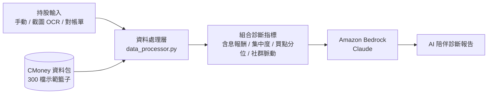

# AI 投資樹洞：存股健診

> CMoney × AWS AI Hackathon 團隊作品

這是一個給「定期定額存股族」用的持股健診工具。使用者輸入持股後，系統會用 CMoney 提供的市場資料計算各項診斷指標，再交給 Amazon Bedrock 上的 Claude 模型，寫成一份像懂投資的朋友在說話的個人化報告。

很多存股族只看帳面損益，看到虧損就焦慮。這個工具把「含息總報酬」、「買點分位」、「社群情緒」一起攤開來看，幫使用者分辨是真的需要調整，還是只是帳面波動。

## 我的分工

- **系統架構設計**：規劃資料處理層、AI 服務層、介面層的分工與資料流
- **網頁初版架構**：建立前端專案骨架與頁面結構
- **UI/UX 設計**：人性化的操作流程與介面設計

## 系統架構



## 功能

整個流程分成三個步驟：

1. **持股導入**：提供三種輸入方式，包括手動輸入、看盤 App 截圖 OCR、電子對帳單解析。OCR 和對帳單的結果會先以可編輯表格呈現，讓使用者確認後才進入分析。
2. **組合診斷**：以整個投資組合為單位計算以下指標：
   - 含息總報酬 vs. 帳面損益
   - 持股集中度
   - 成本在一年價格區間中的分位（含 0050 拆分偵測）
   - 近 30 日社群多空比
   - 下次除息日
   - 對照基準：0050 的年報酬
3. **AI 報告**：把診斷數據交給 Bedrock，生成 220–300 字的繁體中文報告。報告不給直接的投資建議，而是用「值得想想、可以留意」的方式提醒，結尾用即將到來的除息日引導使用者回訪。

**Demo 建議組合**：00919 × 10,000 股 @23.5、2886 兆豐金 × 3,000 股 @42、1101 台泥 × 2,000 股 @38。帳面 -10.7%，但 00919 含息 +6%，同時觸發台泥攤平警示與 00919 同溫層警示（多空比 126×）。

## 專案結構

```
├── ai-investment-companion/    # 主應用（Streamlit）
│   ├── app.py                  # 三步驟介面：持股導入 → 組合診斷 → AI 報告
│   ├── data_processor.py       # 讀取資料包、計算組合診斷指標
│   └── bedrock_service.py      # Amazon Bedrock（Converse API）呼叫
├── checkup-web/                # 網頁版（React + Vite），可部署到 GitHub Pages
│   ├── src/DividendCheckup.jsx # 前端健診介面
│   └── server.py               # FastAPI 後端，轉接 Bedrock
└── test.py                     # 診斷指標與 prompt 的原型驗證
```

## 執行方式

**Streamlit 版**

```bash
cd ai-investment-companion
pip install -r requirements.txt
aws configure                                   # 填入 AWS credentials
export BEDROCK_REGION=us-west-2
export BEDROCK_MODEL_ID=<Bedrock 上的 Claude 模型 ID>
export CMONEY_DATA_DIR=/path/to/Delivery_Hackathon_DataPackage_20260624
streamlit run app.py
```

**網頁版**

```bash
cd checkup-web
npm install
npm run dev                          # 前端 http://localhost:5173
uvicorn server:app --port 8000       # AI 後端（需先設定 server.py 的 MODEL_ID）
```

## 技術

Python、Streamlit、pandas、Amazon Bedrock（Claude）、React、Vite、FastAPI、GitHub Actions

## 資料說明

市場資料由 CMoney 於黑客松期間提供，以 2025/12/31 為基準日，涵蓋 300 檔示範股票與 ETF。
